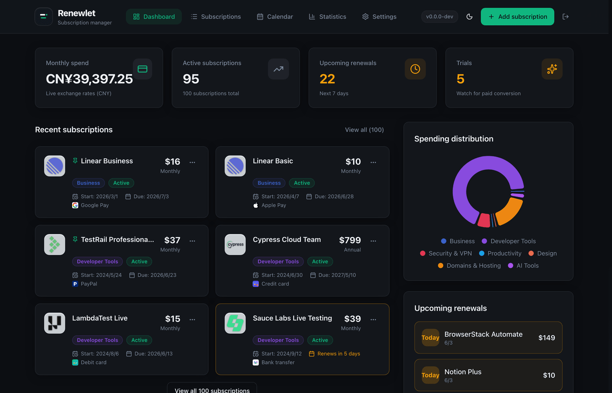
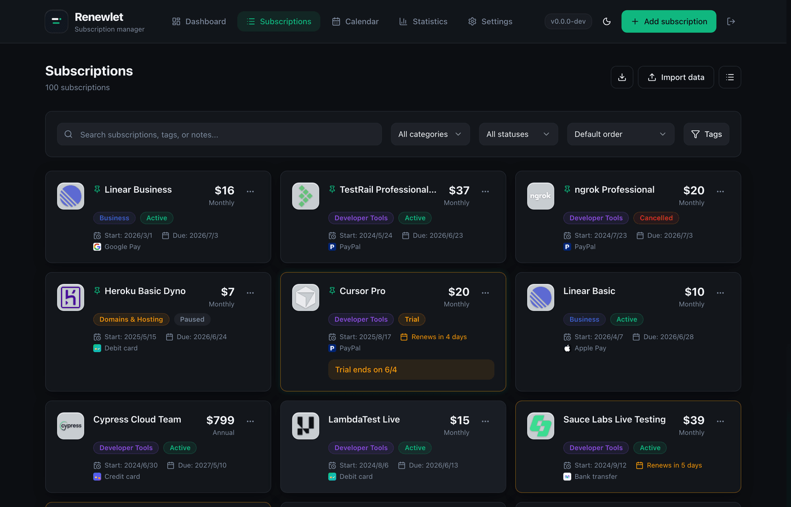
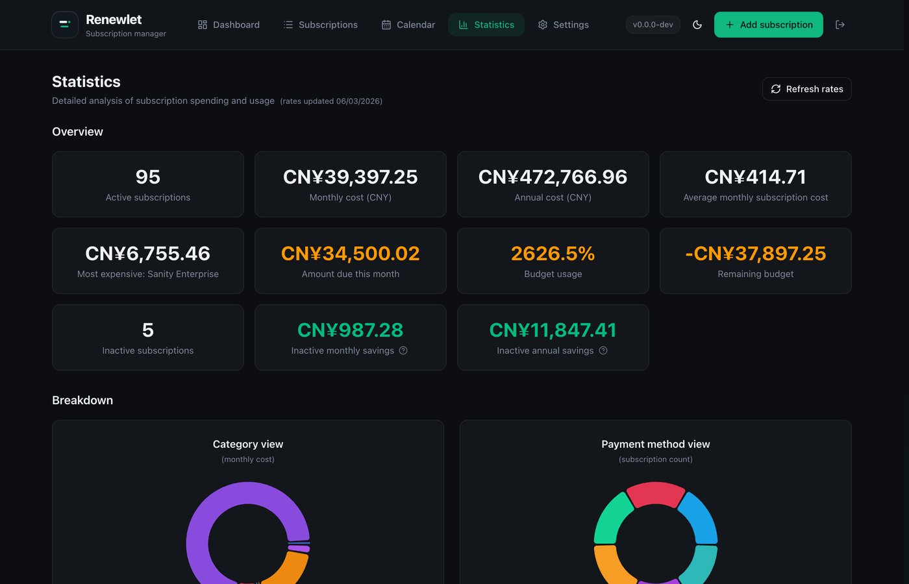
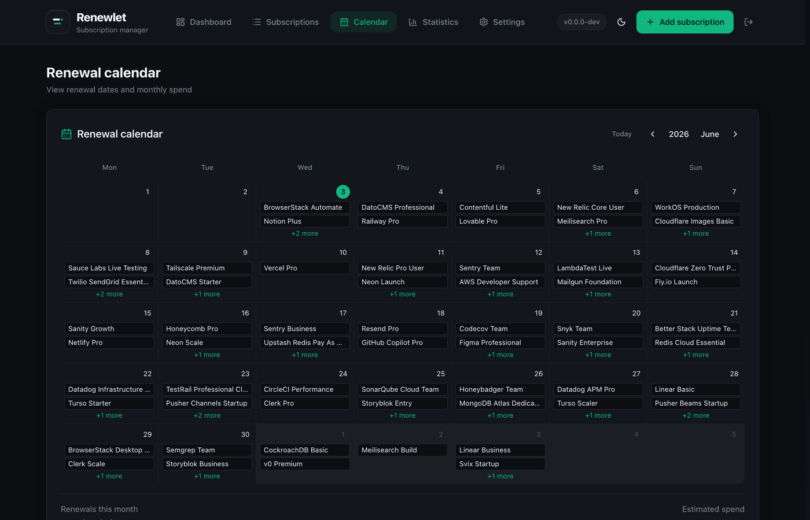
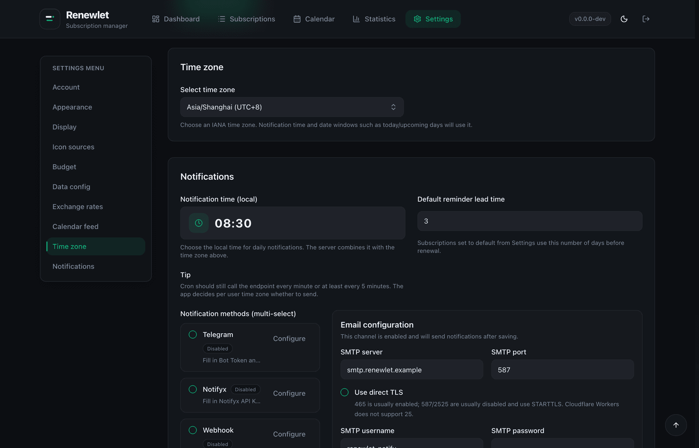
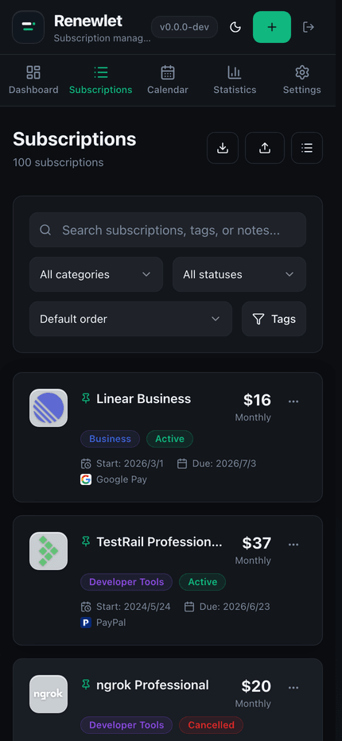
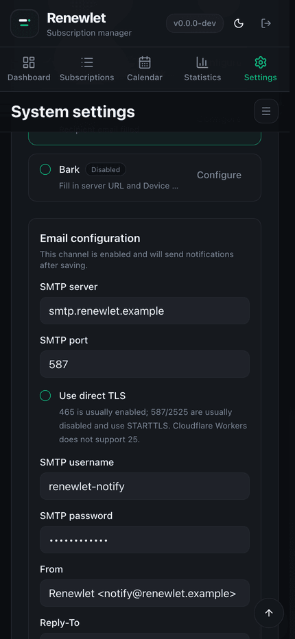

# Renewlet

<p align="center">
  
</p>

<p align="center">
  <a href="README.zh-CN.md">简体中文</a> · <a href="README.md">English</a>
</p>

<p align="center">
  
  
  
  
  
</p>

Renewlet is a self-hosted subscription ledger for recurring expenses. See what you spend, what is due next, and get a reminder before renewal.

Run it in a single Docker container or deploy it to Cloudflare Workers.

## Demo

<https://demo.renewlet.cc/>

Sign in with `demo@renewlet.local` / `renewlet-demo`. Data resets regularly; do not enter real information or credentials.

<p align="center">
  
</p>

## Features

- Keep prices, billing cycles, renewal dates, payment methods, and notes in one place.
- Pause a subscription from its More menu. To resume, choose Active or Trial and review the dates. Family collection reminders continue while paused.
- Review monthly or yearly spending, track a budget, and convert between currencies.
- Send reminders in your timezone through Telegram, Notifyx, Webhook, WeCom, DingTalk, email, Bark, ServerChan, Discord, or PushPlus.
- Turn screenshots, notes, or tables into editable drafts, then review them before import. You can also import or export Renewlet data, or migrate from Wallos.
- Add all or individual subscriptions to a calendar, or share a public status page with prices hidden when needed.
- Secure the account with an authenticator, recovery codes, or passkeys, and optionally protect password login with Cloudflare Turnstile.
- Connect CLI tools, Shortcuts, and other automation through the read-only [Public API](docs/public-api.md).

## Docker Quick Start

Requirements: Docker and Docker Compose v2.

```bash
mkdir -p renewlet && cd renewlet
curl -fsSL https://raw.githubusercontent.com/zhiyingzzhou/renewlet/main/deploy/docker-deploy.sh | bash
docker compose up -d
```

After it starts, open:

```text
http://localhost:3000/setup
```

Create the first administrator. The deploy script creates `docker-compose.yml`, `.env`, and `data/`, then writes `PB_ENCRYPTION_KEY` and `CRON_SECRET`.

For production, pin a stable image tag:

```bash
sed -i.bak 's#RENEWLET_IMAGE=.*#RENEWLET_IMAGE="zhiyingzzhou/renewlet:0.3.39"#' .env
docker compose pull
docker compose up -d
```

If Docker Hub is unavailable, use GHCR:

```env
RENEWLET_IMAGE="ghcr.io/zhiyingzzhou/renewlet:0.3.39"
```

## Cloudflare Workers

<a href="https://deploy.workers.cloudflare.com/?url=https://github.com/zhiyingzzhou/renewlet"></a>

Click the button to deploy. To manage the Cloudflare resources yourself, follow the [Cloudflare Workers deployment guide](docs/cloudflare-workers-deploy.md).

For upgrades, update the existing repository as described in the guide instead of clicking the deploy button again.

## Upgrade

Back up your data and configuration first:

```bash
docker compose stop web &&
(umask 077 && tar -czf "renewlet-backup-$(date +%Y%m%d-%H%M%S).tgz" .env docker-compose.yml data)
```

Keep this archive private. It contains the database, local files and the original `PB_ENCRYPTION_KEY`. If the backup fails, restart the existing service with `docker compose start web` before retrying. To roll back a migration, stop the service and restore the matching data, configuration and image together. The in-app binary update alone cannot restore database state.

Update the Docker image:

```bash
sed -i.bak 's#RENEWLET_IMAGE=.*#RENEWLET_IMAGE="zhiyingzzhou/renewlet:0.3.39"#' .env
docker compose pull
docker compose up -d
docker compose logs -f
```

To update in the app after the backup, start the existing service with `docker compose start web`, then click the version number at the top of Renewlet and open System Update.

## Common Commands

```bash
docker compose ps
docker compose logs -f
docker compose down
```

Common `.env` values:

| Variable | Purpose |
| --- | --- |
| `PORT` | Public port, `3000` by default. |
| `RENEWLET_IMAGE` | Docker image, `zhiyingzzhou/renewlet:latest` by default. |
| `TZ` | Time zone for logs; reminders use each user's time zone. |
| `PB_ENCRYPTION_KEY` | Encryption key for sensitive settings. Do not change it after deployment. |
| `CRON_SECRET` | Bearer secret for external Cron requests. |
| `RENEWLET_DEMO_MODE` | Enables demo mode. `false` by default. |
| `RENEWLET_CUSTOM_HEAD_HTML` | Optional custom `<head>` content. Empty by default. |
| `NOTIFICATION_SCHEDULER_ENABLED` | Enables the built-in notification scheduler. `true` by default. |
| `HTTP_PROXY` / `HTTPS_PROXY` / `NO_PROXY` | Recommended proxy variables for outbound HTTP(S) requests from the Docker server. |

The full Docker environment template is in `.env.example`.

### Upstream Proxy

To proxy HTTP(S) requests made by the Docker server, set these values in `.env`:

```env
HTTP_PROXY="http://host.docker.internal:7890"
HTTPS_PROXY="http://host.docker.internal:7890"
NO_PROXY="localhost,127.0.0.1,.local"
```

Use the uppercase names by default. The lowercase alternatives are `http_proxy`, `https_proxy`, and `no_proxy`. Do not set both forms; when both are present, Go uses the uppercase value.

If the proxy runs on the host, use an address the container can reach instead of `localhost` or `127.0.0.1`. Recreate the container after a change:

```bash
docker compose up -d --force-recreate
```

### Custom Head HTML

To add a third-party service such as [Microsoft Clarity](https://learn.microsoft.com/en-us/clarity/setup-and-installation/clarity-setup), copy the provider's `<head>` code into `RENEWLET_CUSTOM_HEAD_HTML` unchanged. Wrap multiline values in single quotes when using a Docker `.env` file.

Only add code you trust; it can access data on Renewlet pages. Restart the Docker container after a change, or rebuild and redeploy Cloudflare.

## Single sign-on with OpenID Connect

Docker and Cloudflare deployments can each connect one OIDC provider from Settings. Single sign-on is off by default. Password and passkey sign-in remain available.

1. As an administrator, open Renewlet at its usual HTTPS address. Go to **Settings → Access security → Configure single sign-on** and copy the callback URL.
2. Register a confidential web client with the provider and enter the exact callback URL. The provider must support OIDC Discovery, the authorization code flow, PKCE S256 and the `openid` scope. Configure it to issue signed, unencrypted RS256 ID tokens. Its public HTTPS endpoints must be reachable from the browser and the Renewlet server.
3. Enter the discovery document’s exact **issuer** value, client ID and client secret. Choose **Test sign-in**, authenticate at the provider, then choose **Save and enable** on return. Cancelling or failing the test keeps the previous configuration active. Register and test the callback again when changing the public domain or client.
4. Each user first signs in to their existing Renewlet account. Under **Settings → Account → Manage identity link**, enter the current password, authenticate at the provider and confirm the identity on return. The user can then choose single sign-on on the login page. Accounts with local MFA still require the second step. Linking or unlinking signs out other devices.

For authentik, use its default per-application issuer, such as `https://id.example.com/application/o/renewlet/`, including the trailing slash. Select an RSA signing key and leave the encryption key empty. Other providers that meet the same protocol requirements use the same setup. [authentik provider settings](https://docs.goauthentik.io/add-secure-apps/providers/oauth2/)

For a Google web client, enter `https://accounts.google.com` and verify it with **Test sign-in**. For GitHub accounts, configure a GitHub login source in authentik and keep Renewlet connected to the same issuer. [Google OIDC documentation](https://developers.google.com/identity/openid-connect/openid-connect) · [GitHub as an authentik source](https://docs.goauthentik.io/users-sources/sources/social-logins/github/)

Renewlet identifies a linked account by issuer and subject. Site administrators manage user creation and roles in Renewlet. Disabling single sign-on stops new external sign-ins and retains the links. After a provider change, users can sign in locally, unlink their former identity and link the new one. Configure reverse proxies to supply the trusted public scheme and host and to omit query strings from callback access logs.

## Screenshots

<table>
  <tr>
    <td width="50%">
      <strong>AI recognition</strong><br>
      
    </td>
    <td width="50%">
      <strong>Public subscription status page</strong><br>
      
    </td>
  </tr>
  <tr>
    <td width="50%">
      <strong>Subscriptions</strong><br>
      
    </td>
    <td width="50%">
      <strong>Statistics</strong><br>
      
    </td>
  </tr>
  <tr>
    <td width="50%">
      <strong>Renewal calendar</strong><br>
      
    </td>
    <td width="50%">
      <strong>Notifications</strong><br>
      
    </td>
  </tr>
</table>

### Mobile

<table>
  <tr>
    <td width="50%">
      <strong>Mobile subscriptions</strong><br>
      
    </td>
    <td width="50%">
      <strong>Mobile notification methods</strong><br>
      
    </td>
  </tr>
</table>

## Contributing

Issues, documentation fixes, tests, and pull requests are welcome. For larger changes, open an issue first with the goal, use case, and rough approach.

## License

Renewlet is open-sourced under the [MIT License](LICENSE).
