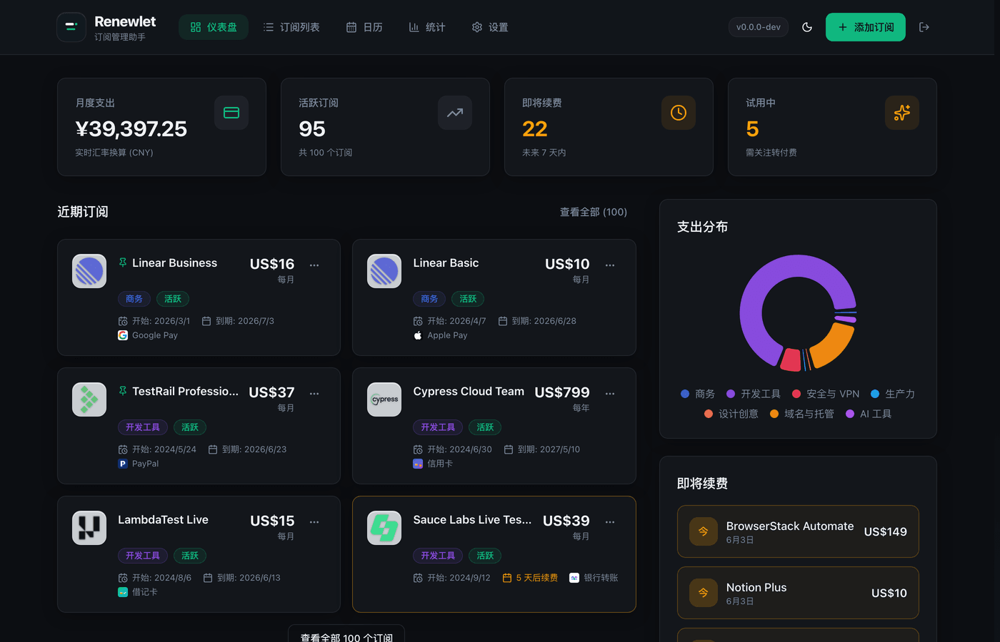
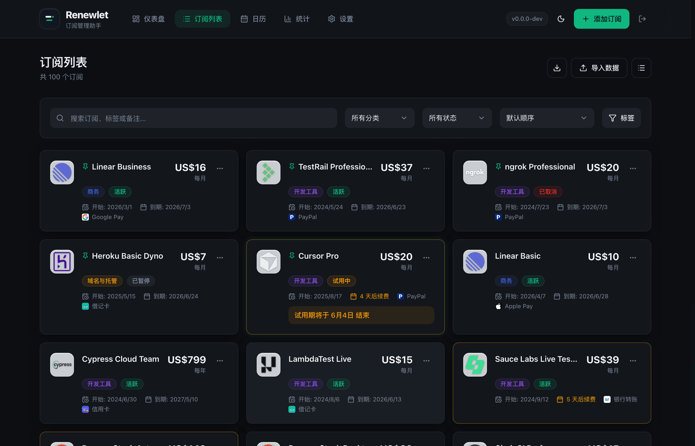
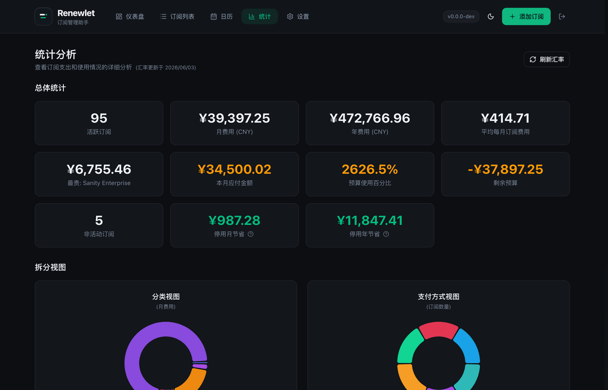
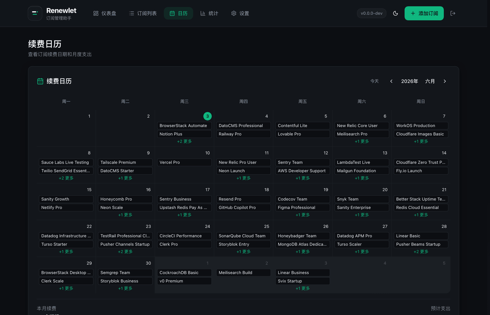
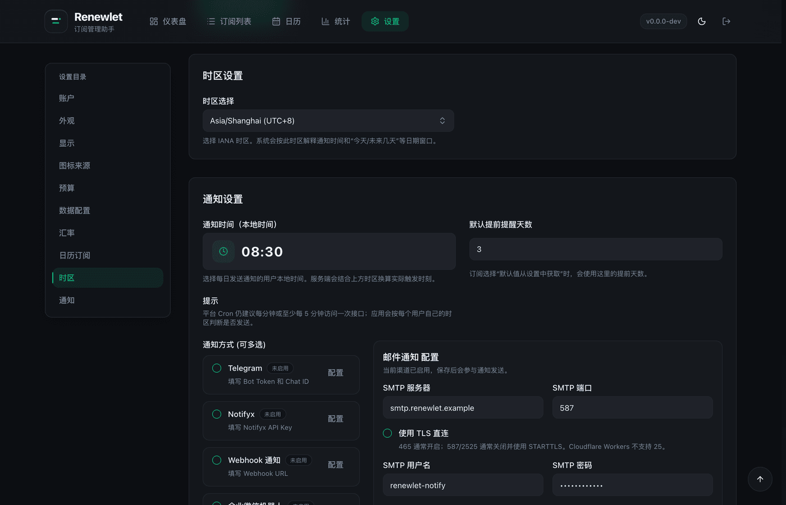
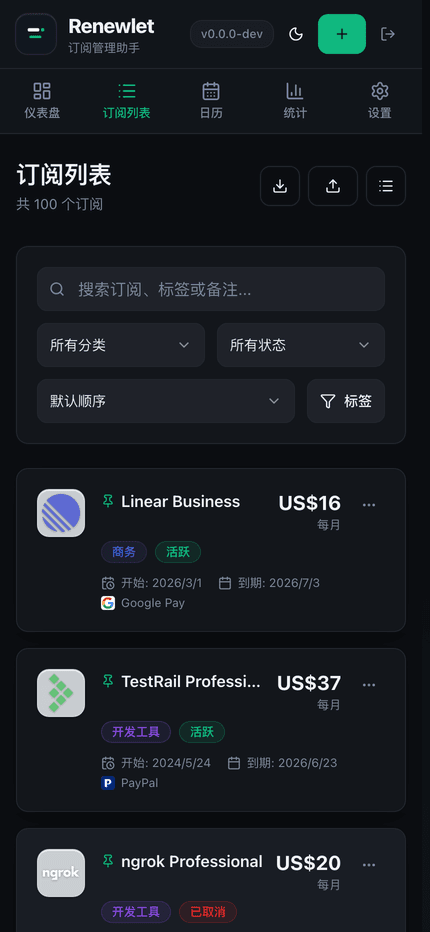
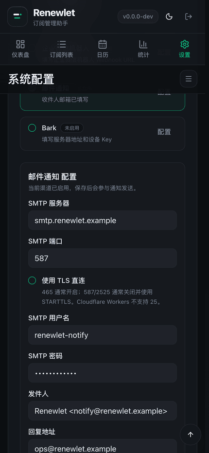

# Renewlet

<p align="center">
  
</p>

<p align="center">
  <a href="README.zh-CN.md">简体中文</a> · <a href="README.md">English</a>
</p>

<p align="center">
  
  
  
  
  
</p>

Renewlet 是一个会在续费前提醒你的自托管订阅账本。把订阅和其他周期支出记进去，就能看到每月花多少、下一笔什么时候扣。

可以用 Docker 单容器运行，也可以部署到 Cloudflare Workers。

## 在线演示

<https://demo.renewlet.cc/>

使用 `demo@renewlet.local` / `renewlet-demo` 登录。数据会定期重置，请勿填写真实信息或凭据。

<p align="center">
  
</p>

## 功能

- 记录订阅：价格、扣费周期、续费日、付款方式和备注都放在一处。
- 在订阅的「更多操作」里暂停订阅。恢复时选择活跃或试用并核对日期。暂停期间仍可收到家庭共享收款提醒。
- 查看支出：按月或按年汇总费用，跟踪预算并换算不同币种。
- 续费提醒：按你的时区提前发送，渠道包括 Telegram、Notifyx、Webhook、企业微信、钉钉、邮件、Bark、Server酱、Discord 和 PushPlus。
- 录入和迁移：从截图、备忘录或表格生成可编辑草稿，确认后再导入；也可以导入导出 Renewlet 数据或迁入 Wallos 文件。
- 日历和分享：把全部或单个订阅加入日历，或生成可隐藏金额的公开状态页。
- 账号安全：使用身份验证器、恢复码或通行密钥，也可以为密码登录开启 Cloudflare Turnstile。
- 自动化：通过只读 [Public API](docs/public-api.md) 接入 CLI、Shortcuts 和其他工具。

## 快速部署

需要 Docker 和 Docker Compose v2。

```bash
mkdir -p renewlet && cd renewlet
curl -fsSL https://raw.githubusercontent.com/zhiyingzzhou/renewlet/main/deploy/docker-deploy.sh | bash
docker compose up -d
```

启动后打开：

```text
http://localhost:3000/setup
```

创建第一个管理员。部署脚本会生成 `docker-compose.yml`、`.env` 和 `data/`，并写入 `PB_ENCRYPTION_KEY` 与 `CRON_SECRET`。

正式使用时建议固定版本：

```bash
sed -i.bak 's#RENEWLET_IMAGE=.*#RENEWLET_IMAGE="zhiyingzzhou/renewlet:0.3.39"#' .env
docker compose pull
docker compose up -d
```

如果 Docker Hub 拉取不可用，改用 GHCR：

```env
RENEWLET_IMAGE="ghcr.io/zhiyingzzhou/renewlet:0.3.39"
```

## Cloudflare Workers

<a href="https://deploy.workers.cloudflare.com/?url=https://github.com/zhiyingzzhou/renewlet"></a>

点击上方按钮直接部署。需要自己管理 Cloudflare 资源时，请按 [Cloudflare Workers 部署](docs/cloudflare-workers-deploy.zh-CN.md) 操作。

升级已有实例时不要再次点击部署按钮，按部署文档同步现有仓库即可。

## 升级

升级前先备份数据和配置：

```bash
docker compose stop web &&
(umask 077 && tar -czf "renewlet-backup-$(date +%Y%m%d-%H%M%S).tgz" .env docker-compose.yml data)
```

请妥善保管备份，它包含数据库、本地文件和原始 `PB_ENCRYPTION_KEY`。备份失败时，先用 `docker compose start web` 恢复原服务。回退数据迁移时，请停服并一起恢复同一备份的数据、配置和对应镜像。应用内的程序更新只管理二进制文件。

更新 Docker 镜像：

```bash
sed -i.bak 's#RENEWLET_IMAGE=.*#RENEWLET_IMAGE="zhiyingzzhou/renewlet:0.3.39"#' .env
docker compose pull
docker compose up -d
docker compose logs -f
```

如果选择应用内更新，备份后先执行 `docker compose start web` 启动原服务，再点击页面顶部的版本号，打开“系统更新”。

## 常用命令

```bash
docker compose ps
docker compose logs -f
docker compose down
```

常用 `.env` 配置：

| 变量 | 用途 |
| --- | --- |
| `PORT` | 对外端口，默认 `3000`。 |
| `RENEWLET_IMAGE` | Docker 镜像，默认 `zhiyingzzhou/renewlet:latest`。 |
| `TZ` | 日志时区；提醒使用每个用户设置的时区。 |
| `PB_ENCRYPTION_KEY` | 敏感设置加密密钥，部署后不要更换。 |
| `CRON_SECRET` | 外部 Cron 请求使用的 Bearer 密钥。 |
| `RENEWLET_DEMO_MODE` | 是否开启演示模式，默认 `false`。 |
| `RENEWLET_CUSTOM_HEAD_HTML` | 可选的自定义 `<head>` 内容，默认留空。 |
| `NOTIFICATION_SCHEDULER_ENABLED` | 是否启用内置通知调度器，默认 `true`。 |
| `HTTP_PROXY` / `HTTPS_PROXY` / `NO_PROXY` | Docker 服务端发出 HTTP(S) 请求时推荐使用的代理变量。 |

完整 Docker 环境变量模板见 `.env.example`。

### 上游代理

Docker 服务端发出的 HTTP(S) 请求需要代理时，在 `.env` 中配置：

```env
HTTP_PROXY="http://host.docker.internal:7890"
HTTPS_PROXY="http://host.docker.internal:7890"
NO_PROXY="localhost,127.0.0.1,.local"
```

默认使用大写变量。小写备选名为 `http_proxy`、`https_proxy` 和 `no_proxy`。不要同时配置大小写两组变量；两组同时存在时，Go 优先读取大写值。

代理运行在宿主机时，请填写容器可以访问的地址，不要使用 `localhost` 或 `127.0.0.1`。修改后重新创建容器：

```bash
docker compose up -d --force-recreate
```

### 自定义 Head HTML

需要接入 [Microsoft Clarity](https://learn.microsoft.com/zh-cn/clarity/setup-and-installation/clarity-setup) 等第三方服务时，把服务商提供的 `<head>` 代码原样填入 `RENEWLET_CUSTOM_HEAD_HTML`。Docker `.env` 中的多行代码用单引号包裹。

只添加你信任的代码，它可以访问 Renewlet 页面中的数据。修改后，Docker 部署需重启容器，Cloudflare 部署需重新构建并部署。

## 单点登录（OpenID Connect）

Docker 和 Cloudflare 部署均可在设置页接入一个 OIDC 身份提供方。默认关闭，已有用户可继续用密码或通行密钥登录。

1. 管理员通过平时访问 Renewlet 的 HTTPS 域名打开 **设置 → 访问安全 → 配置单点登录**，复制回调地址。
2. 在提供方创建机密 Web 客户端，将回调地址原样登记为精确匹配。客户端需支持 OIDC Discovery、授权码流程、PKCE S256 和 `openid` 范围，并签发 RS256 签名的非加密 ID Token。浏览器和 Renewlet 后端都需要能访问提供方的公网 HTTPS 端点。
3. 在 Renewlet 填入 Discovery 文档的 **issuer** 原值、客户端 ID 和密钥。选择 **测试登录**，在提供方完成认证，返回后选择 **保存并启用**。取消或测试失败时，原配置继续生效。更换域名或客户端时，重新登记回调并测试。
4. 每位用户先用已有 Renewlet 账号登录，在 **设置 → 账号 → 管理绑定** 输入当前密码，前往提供方认证，返回核对身份并确认。此后可在登录页选择单点登录。已开启身份验证器的账号仍需完成本地第二步验证。绑定和解绑后，其他设备需要重新登录。

authentik 可使用默认的每应用 issuer，例如 `https://id.example.com/application/o/renewlet/`，保留末尾斜杠。选择 RSA 签名密钥，清空加密密钥。其他符合上述协议要求的提供方也可使用同一个入口。[authentik 提供方配置](https://docs.goauthentik.io/add-secure-apps/providers/oauth2/)

Google 的 Web 客户端可填写 `https://accounts.google.com` 并通过测试登录确认。若希望用 GitHub 账号登录，可在 authentik 中添加 GitHub 登录源，Renewlet 仍连接同一个 issuer。[Google OIDC 文档](https://developers.google.com/identity/openid-connect/openid-connect) · [authentik 的 GitHub 登录源](https://docs.goauthentik.io/users-sources/sources/social-logins/github/)

绑定按提供方和用户标识识别，Renewlet 的用户创建和角色分配仍由本站管理员管理。停用单点登录会关闭新的外部登录并保留绑定。若更换提供方，用户可用本地方式登录，解绑后重新绑定。反向代理应传递可信的公网协议和主机名，并在回调路径的访问日志中省略查询参数。

## 截图

<table>
  <tr>
    <td width="50%">
      <strong>AI 识别订阅</strong><br>
      
    </td>
    <td width="50%">
      <strong>公开订阅状态页</strong><br>
      
    </td>
  </tr>
  <tr>
    <td width="50%">
      <strong>订阅清单</strong><br>
      
    </td>
    <td width="50%">
      <strong>统计分析</strong><br>
      
    </td>
  </tr>
  <tr>
    <td width="50%">
      <strong>续费日历</strong><br>
      
    </td>
    <td width="50%">
      <strong>通知设置</strong><br>
      
    </td>
  </tr>
</table>

### 移动端

<table>
  <tr>
    <td width="50%">
      <strong>移动端订阅列表</strong><br>
      
    </td>
    <td width="50%">
      <strong>移动端通知方式</strong><br>
      
    </td>
  </tr>
</table>

## 贡献

欢迎提交 issue、文档修正、测试或 pull request。较大的变更请先开 issue，说明目标、使用场景和大致方案。

## 许可证

Renewlet 基于 [MIT License](LICENSE) 开源。
