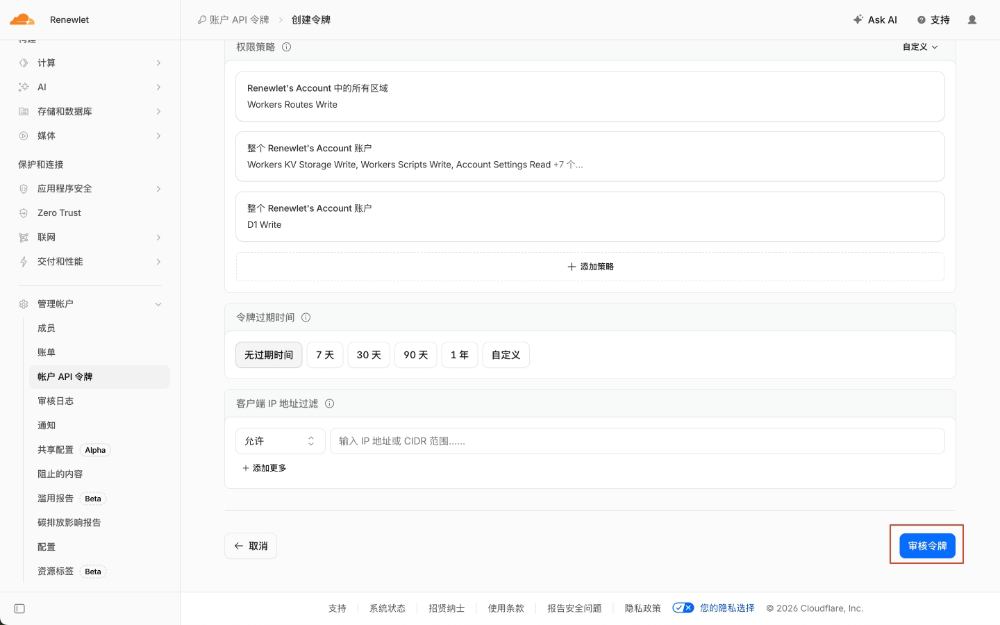
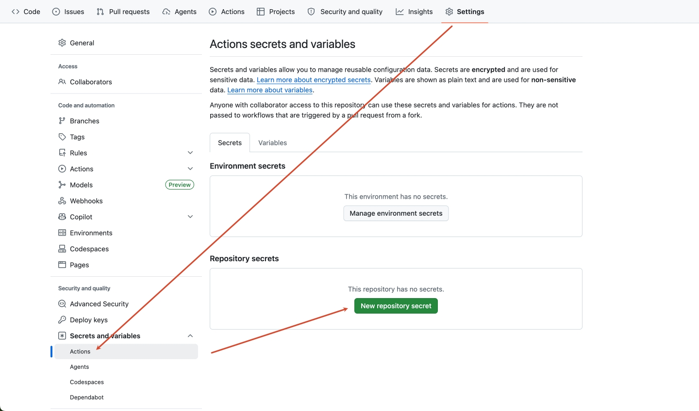
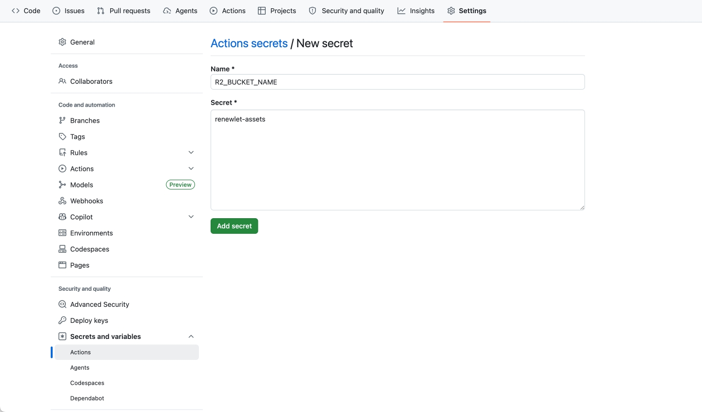
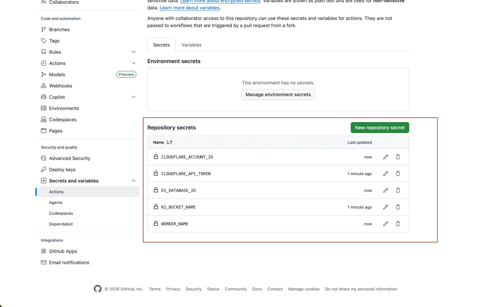
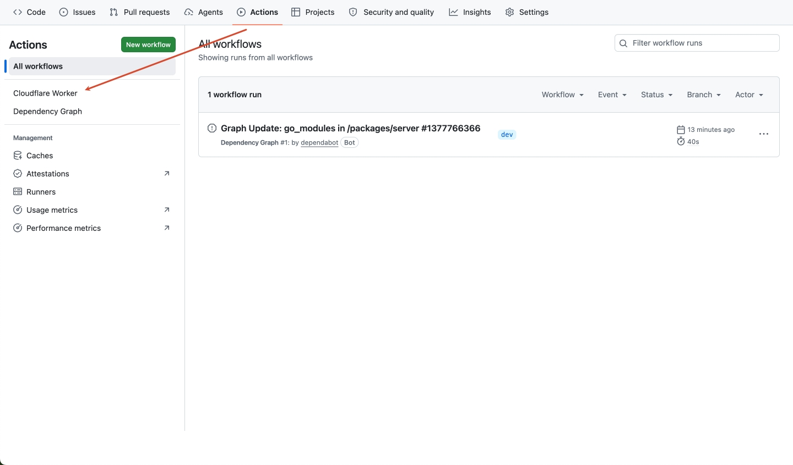
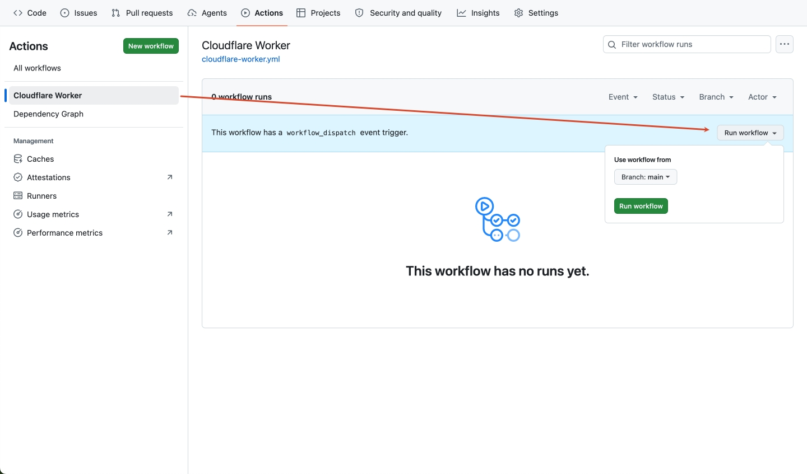
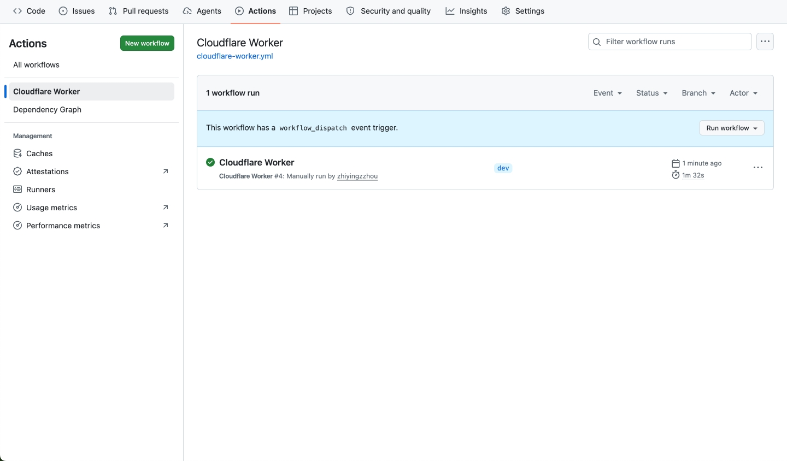
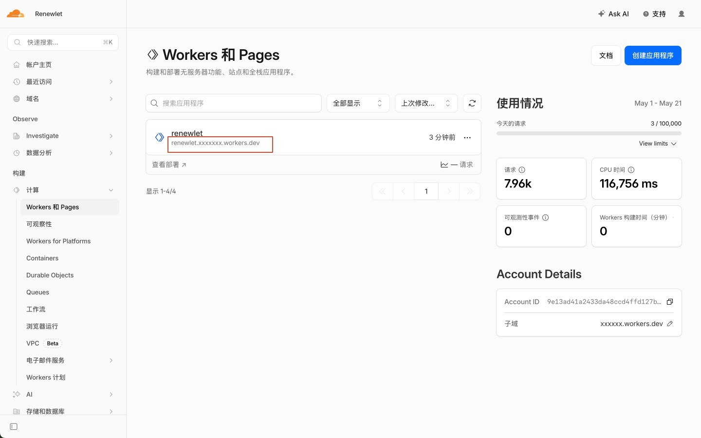
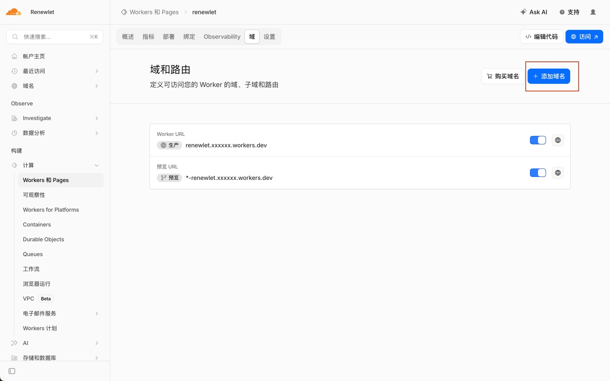

# Cloudflare Workers 部署

## 推荐：一键部署

<a href="https://deploy.workers.cloudflare.com/?url=https://github.com/zhiyingzzhou/renewlet"></a>

1. 点击按钮。
2. 登录或授权 Cloudflare。
3. 按 Cloudflare 向导完成部署。
4. 打开：

```text
https://<worker-name>.<workers-dev-subdomain>.workers.dev/setup
```

保持生成的部署命令为 `pnpm deploy`。Renewlet 会自动准备部署所需资源并发布 Worker，不需要把命令改成手写 Wrangler 步骤。

### 无法获取存储库内容

如果 Cloudflare 页面提示 `Failed to get repository contents` / `无法获取存储库内容`，通常是部署向导读取 GitHub 公共仓库时遇到临时限流或网络出口问题，不代表 Renewlet 服务端或 Worker 代码部署失败。

如果你使用代理节点、公司/校园网络或其他共享网络出口，当前出口 IP 也可能被 GitHub 或 Cloudflare 临时限流。不要连续重试；可以稍后再试、切换更稳定的代理节点/网络出口；仍失败时，改用下面的手动部署流程。

### 升级办法

一键部署会在你的 GitHub 账号下生成并连接一个仓库。以后升级 Renewlet 时，请更新这个生成仓库；不要重新点一键部署按钮，否则可能创建新的 Worker/D1/R2，而不是升级现有实例。

先在 Cloudflare Dashboard 打开 Renewlet Worker，进入 `Settings` -> `Builds`，找到 Cloudflare Builds 连接的生成仓库。这个生成仓库不是标准 GitHub fork，所以不会有 GitHub 原生的 `Sync fork` 按钮。

打开生成仓库后：

1. 进入 `Actions`。
2. 选择 `Sync Renewlet Upstream`。
3. 点击 `Run workflow`。
4. 等待 workflow 完成。

这个 workflow 只在你手动点击时运行，不会定时自动更新。运行后，它会把生成仓库更新到 Renewlet 最新文件，同时保留 `wrangler.jsonc` 里的已有 Cloudflare 资源配置和 vars。workflow 提交完成后，Cloudflare Builds 会按这个提交自动重新部署。

如果 GitHub 提示 Actions 被禁用，先在生成仓库打开 `Settings` -> `Actions` -> `General`，启用 Actions，并在 `Workflow permissions` 里允许 `Read and write permissions`。

### 旧一键部署用户

旧 GitHub 生成仓库可能没有 `Sync Renewlet Upstream`。不要重新点一键部署；继续使用原来的 Worker、D1、R2 和生成仓库。

如果在 `Actions` 里看不到这个 workflow，只需要在原生成仓库里一次性添加：

```text
.github/workflows/sync-renewlet-upstream.yml
```

从这个 workflow 复制文件内容：[sync-renewlet-upstream.yml](https://raw.githubusercontent.com/zhiyingzzhou/renewlet/main/.github/workflows/sync-renewlet-upstream.yml)。

提交后，以后升级就和新用户一样，进入 `Actions` -> `Sync Renewlet Upstream` -> `Run workflow`。

如果你想自己创建 D1/R2、Cloudflare API Token 和 GitHub Secrets，可以继续使用下面的手动部署流程。

## 手动部署（GitHub Actions）

手动部署适合想自己管理 Cloudflare 资源和 GitHub Actions 的用户。准备好下面 5 个值后，在你的 fork 仓库里运行 `Cloudflare Worker`，由它完成检查和部署。

流程：

- 检查 Cloudflare Worker 和前端类型
- 构建 Cloudflare 前端
- 如果 5 个 GitHub Secrets 都已配置，根据 Secrets 生成 `wrangler.generated.jsonc`
- 如果 5 个 GitHub Secrets 都已配置，准备 Cloudflare 资源并部署 Worker

如果缺少任意必需 secret，workflow 仍会运行 Cloudflare 检查和构建，然后通过 GitHub Actions notice 明确跳过远端 D1 migration 和 Worker 部署。

把下面 5 个值填进 GitHub Secrets 后才会启用远端部署。

### 1. Fork 仓库

把 Renewlet 仓库 Fork 到自己的账号或组织。

仓库名已存在：使用已有 fork，或换一个仓库名。

### 2. 创建 Cloudflare 资源

在 Cloudflare 控制台创建 D1 数据库和 R2 bucket。

D1：

1. 打开 Cloudflare 控制台的 `存储和数据库` -> `D1 SQL 数据库`。
2. 点击 `创建数据库`。

   

3. 数据库名填 `renewlet`。

   

4. 打开创建好的数据库，复制 database ID，作为 `D1_DATABASE_ID`。

   

R2：

1. 打开 Cloudflare 控制台的 `存储和数据库` -> `R2 对象存储`。

   

2. 创建 bucket，名称填 `renewlet-assets`。

   

3. 复制 bucket 名，作为 `R2_BUCKET_NAME`。

   

Renewlet 的 Worker binding 名固定如下：

| Binding | Cloudflare 产品 | 用途 |
| --- | --- | --- |
| `DB` | D1 | 用户、会话、订阅、设置、通知任务 |
| `ASSETS` | Workers Static Assets | React 应用和内置图标 seed 索引 |
| `ASSETS_BUCKET` | R2 | 私有上传 Logo/Icon |

后台刷新内置图标索引会用到 Cloudflare Queues。`pnpm deploy`、GitHub Actions workflow 和下面的可选 Wrangler CLI 流程会自动创建所需 Queues，通常不需要在控制台手动管理。

### 3. 获取 CLOUDFLARE_ACCOUNT_ID

直达入口：<a href="https://dash.cloudflare.com/?to=/:account/home" target="_blank" rel="noopener noreferrer">https://dash.cloudflare.com/?to=/:account/home</a>

1. 打开 Cloudflare Dashboard。
2. 进入 `账户主页`。
3. 找到部署 Renewlet 的账号行。
4. 点击账号行右侧菜单按钮。
5. 点击 `复制帐户 ID`。
6. 把复制值保存为 `CLOUDFLARE_ACCOUNT_ID`。


也可以从 `Workers & Pages` 页面复制：打开 `Workers & Pages`，在 `Account details` 里点击 `Account ID` 的复制按钮。

直达入口：<a href="https://dash.cloudflare.com/?to=/:account/workers-and-pages" target="_blank" rel="noopener noreferrer">https://dash.cloudflare.com/?to=/:account/workers-and-pages</a>


### 4. 创建 CLOUDFLARE_API_TOKEN

直达入口：<a href="https://dash.cloudflare.com/?to=/:account/api-tokens" target="_blank" rel="noopener noreferrer">https://dash.cloudflare.com/?to=/:account/api-tokens</a>

权限：`Edit Cloudflare Workers` + `Account` -> `D1` -> `Edit` + `Queues Edit`。资源范围选部署 Renewlet 的账号；绑定自定义域名时，zone 选对应域名。

1. 打开 Cloudflare Dashboard。
2. 进入 `帐户 API 令牌` 页面。
3. 点击 `创建令牌`。

   

4. 令牌名称 填 `renewlet-worker-deploy`。
5. 在 `权限策略` 里打开 `Custom` 下拉框，选择 `Edit Cloudflare Workers`。

   

6. 在权限列表里新增 `Account` -> `D1` -> `Edit` 和 `Queues Edit`。

   

   
   
7. 向下滚动到 `资源` 区域。
8. 如果页面显示 `帐户资源`：选择 `包括` -> 部署 Renewlet 的 Cloudflare 账号。
9. 如果页面显示 `区域资源`：选择后面要绑定 Worker route 或 custom domain 的域名。
10. 如果页面没有资源选择区，直接点击 `审核令牌`。

    

11. 检查 令牌名称、权限策略 和 资源(没有的话跳过)。
12. 点击 `创建令牌`。

    

13. 复制生成的 token，保存为 `CLOUDFLARE_API_TOKEN`。**请立刻保存，token 只显示一次。**

    

    

### 5. 配置 GitHub Secrets

在你的 fork 仓库里打开 `Settings` -> `Secrets and variables` -> `Actions` -> `New repository secret`，添加下面 5 个必需 repository secrets：

| Secret | 值 |
| --- | --- |
| `CLOUDFLARE_API_TOKEN` | 用于 GitHub Actions 调用 Wrangler 部署 Worker 并应用远端 D1 migrations 的 Cloudflare API Token |
| `CLOUDFLARE_ACCOUNT_ID` | 部署 Renewlet 的 Cloudflare account ID |
| `WORKER_NAME` | Worker 名称，例如 `renewlet` 或 `renewlet-prod` |
| `D1_DATABASE_ID` | 从 Cloudflare 控制台复制的 D1 database ID |
| `R2_BUCKET_NAME` | R2 bucket 名称，例如 `renewlet-assets` |







### 6. 运行部署

工作流文件在 `.github/workflows/cloudflare-worker.yml`。

首次部署建议从 GitHub Actions 手动运行。以后升级时，先把你的 fork 更新到 Renewlet 最新版本；如果仓库已启用 Actions，更新后会自动重新部署，也可以随时从 GitHub Actions 手动运行：

workflow 需要上面 5 个必需 repository secrets 才会部署到 Cloudflare。没有配齐时，它只验证 Cloudflare 构建路径，不会修改任何远端 D1 数据库或 Worker。

1. 打开你的 fork 仓库。
2. 进入 `Actions`。
3. 选择 `Cloudflare Worker`。
4. 点击 `Run workflow`。







### 7. 打开 Renewlet

默认访问地址是：

```text
https://<WORKER_NAME>.<workers-dev-subdomain>.workers.dev/setup
```



自定义域名：部署后在 Cloudflare 控制台为 Worker 绑定 route 或 custom domain。



## 更新版本

一键部署用户：按上面的“升级办法”，在 Cloudflare Builds 连接的生成仓库里运行 `Sync Renewlet Upstream`。

手动部署用户：在你的 fork 里点击 `Sync fork` / `Update branch`，把 fork 更新到 Renewlet 最新版本。如果没有自动部署，进入 `Actions` 手动运行 `Cloudflare Worker`。

## D1 升级与恢复

升级 schema 前，先创建一份可移植 SQL 导出。`pnpm deploy` 会在首次 D1 写入前自动捕获当前 Time Travel bookmark 和线上 Worker version，并写入 GitHub job summary 或本地输出。

```bash
pnpm exec wrangler d1 export DB --remote --config wrangler.generated.jsonc --output renewlet-before-upgrade.sql
```

普通升级保持在线。检测到尚未应用的 `_exclusive_` 排他 migration，或 `subscription-derived-state-v5` marker 仍待回填时，部署编排器会先用同一份 Worker bundle 部署维护配置，解绑 Cron 和 Queue consumer，并等待 Cloudflare 后台 invocation 的 15 分钟最长执行时间。API、ICS 和 webhook 返回带 `Retry-After: 900`、`Cache-Control: no-store` 的 `503`，Static Assets 仍继续提供 SPA。

```bash
pnpm deploy -- --config wrangler.generated.jsonc --maintenance-config wrangler.maintenance.generated.jsonc
```

排空后，编排器会保护日历 Feed、执行 migration、重建派生状态、检查外键以及 settings 数据/trigger 完整定义，再部署正常配置并校验 active Worker version。首次 D1 写入前失败会自动恢复旧 Worker、Cron 和 Queue consumer；首次写入后失败则保持或重新部署维护模式。修复原因后重跑同一条 deploy 命令即可；已写入的 migration marker 会被复核，不会重复执行已完成 migration。

维护部署显式解绑本 Worker 在配置队列及死信队列上的消费者，并回读 Cron 和消费者状态。排空后，维护版本保存原正常 Worker 的版本号和此时的 D1 bookmark，重试沿用这组恢复信息。已有 v4 完成标记的数据库只清理停用订阅的重复提醒，保留其他订阅原排程；更早版本从订阅事实重建。两条路径均在校验通过后登记 v5。

如果决定回退数据契约，必须先审查 checkpoint 之后的所有写入。恢复会原地覆盖数据，只能使用下面的统一命令：它先部署维护配置并排空后台任务，D1 restore 成功后才回滚 Worker 和恢复触发器。排他 migration 后禁止单独执行 Worker rollback。

```bash
pnpm cloudflare:deploy:recover -- --config wrangler.generated.jsonc --maintenance-config wrangler.maintenance.generated.jsonc --bookmark "<bookmark>" --worker-version "<version-id>"
```

也可以从 `renewlet-before-upgrade.sql` 创建替代 D1 数据库，复核 binding 后仍按同一套维护优先恢复流程操作。失败后才捕获的 bookmark 不能替代升级前 checkpoint。

Docker 与 Cloudflare 运行面的云备份快照上限统一为 16 MiB。若旧版本曾允许更大快照，升级前必须先用旧版本下载或恢复所有超过 16 MiB 的远端快照。

导入、浏览器导出和云备份内容统一使用稳定的 `renewlet-export` schema v1；`renewlet-cloud-backup-snapshot` 传输封装同样保持 schema v1，并通过 `exportSchemaVersion=1` 声明内部载荷。

## 可选：Wrangler CLI

普通部署不需要使用 Wrangler CLI。只有你想在本机直接管理 Cloudflare 资源时，再使用下面的命令。

创建资源：

```bash
pnpm install --frozen-lockfile
pnpm exec wrangler login
pnpm exec wrangler d1 create renewlet
pnpm exec wrangler r2 bucket create renewlet-assets
```

导出真实值并部署：

```bash
export CLOUDFLARE_API_TOKEN="..."
export CLOUDFLARE_ACCOUNT_ID="..."
export WORKER_NAME="renewlet"
export D1_DATABASE_ID="..."
export R2_BUCKET_NAME="renewlet-assets"
export CI_WRANGLER_CONFIG="wrangler.generated.jsonc"
export CI_WRANGLER_MAINTENANCE_CONFIG="wrangler.maintenance.generated.jsonc"
export CLOUDFLARE_OBSERVABILITY_PROFILE="development"

pnpm cloudflare:config:ci
pnpm check:cloudflare
pnpm build:cloudflare
pnpm deploy -- --config wrangler.generated.jsonc --maintenance-config wrangler.maintenance.generated.jsonc
```

## 其他配置

| 名称 | 类型 | 用途 |
| --- | --- | --- |
| `SETUP_ENABLED` | Worker var | `/setup` 开关，默认 `true` |
| `SESSION_TTL_DAYS` | Worker var | 登录有效期，默认 30 天 |
| `VITE_RENEWLET_RUNTIME=cloudflare` | 构建变量 | 前端使用 Worker API |

## 常见情况

**Worker 名称已存在怎么办？**

修改 GitHub Secrets 里的 `WORKER_NAME`，重新运行 workflow。

**日历订阅提示 `no such table: calendar_feeds`？**

说明旧部署没有完成远端 D1 状态机。重新运行 `Cloudflare Worker` workflow，或在本地执行同一个部署编排器：

```bash
pnpm cloudflare:config:ci
pnpm build:cloudflare
pnpm deploy -- --config wrangler.generated.jsonc --maintenance-config wrangler.maintenance.generated.jsonc
```

**Server酱测试通知返回 HTTP 429？**

这是 Server酱返回的限流错误，不是 Renewlet 通知参数格式错误。Server酱官方 FAQ 写明：`429` 是来源 IP 在 24 小时内调用 API 次数超过限制，处理办法是停止调用 24 小时后再试。

Renewlet 部署在 Cloudflare Workers 后，Server酱请求由 Worker 发出；Server酱统计的是 Worker 出站到 Server酱时的来源 IP。真正原因通常是这个 Cloudflare 出站来源 IP 触发了 Server酱的 24 小时限流。

处理办法：

- 立刻停止连续测试，等 24 小时后再试。
- 急用通知时，先切到 SMTP、Telegram、Bark 或 Webhook。
- Renewlet 会按 SendKey 自动选择入口：`sctp...` 会发到 [Server酱³ 官方 API 入口](https://doc2.ft07.com/zh/serverchan3/server/api) `https://<uid>.push.ft07.com/send/<sendkey>.send`；`SCT...` 会发到 Server酱 Turbo 的 `https://sctapi.ftqq.com/<sendkey>.send`。如果你填的是 `sctp...` SendKey，这里已经不是 [SCT 转发](https://doc2.ft07.com/zh/serverchan3/compatibility/sct-forward)入口；继续返回 429，原因仍是 Server酱对 Cloudflare 出站来源 IP 的 24 小时限流。

**旧 `pb_data`？**

走单独导出/导入流程。
